<!-- i18n-source: README.md@064e2227318fe11006d8584defd9c98001cac064 status=reviewed -->
<!-- brand:start -->

<p align="center"><picture><source media="(prefers-color-scheme: dark)" srcset="https://raw.githubusercontent.com/muhittincamdali/asnsim/main/.github/brand/banner-dark.svg"><source media="(prefers-color-scheme: light)" srcset="https://raw.githubusercontent.com/muhittincamdali/asnsim/main/.github/brand/banner-light.svg"></picture></p>

<!-- lang-selector:start -->
<p align="center"><a href="README.md">English</a> · <a href="README.tr.md">Türkçe</a> · <a href="README.zh-CN.md">简体中文</a> · <a href="README.ja.md">日本語</a> · <a href="README.ko.md">한국어</a> · <a href="README.es.md">Español</a> · <a href="README.de.md">Deutsch</a> · <a href="README.fr.md">Français</a> · <a href="README.pt-BR.md">Português (Brasil)</a> · <a href="README.ru.md">Русский</a></p>
<!-- lang-selector:end -->

<p align="center">
<a href="https://github.com/muhittincamdali/asnsim/actions/workflows/ci.yml"></a>
<a href="https://github.com/muhittincamdali/asnsim/releases"><picture><source media="(prefers-color-scheme: dark)" srcset="https://raw.githubusercontent.com/muhittincamdali/asnsim/main/.github/brand/badge-version-dark.svg"><source media="(prefers-color-scheme: light)" srcset="https://raw.githubusercontent.com/muhittincamdali/asnsim/main/.github/brand/badge-version-light.svg"></picture></a>
<a href="https://github.com/muhittincamdali/asnsim/blob/main/package.json"><picture><source media="(prefers-color-scheme: dark)" srcset="https://raw.githubusercontent.com/muhittincamdali/asnsim/main/.github/brand/badge-language-dark.svg"><source media="(prefers-color-scheme: light)" srcset="https://raw.githubusercontent.com/muhittincamdali/asnsim/main/.github/brand/badge-language-light.svg"></picture></a>
<a href="https://github.com/muhittincamdali/asnsim/blob/main/LICENSE"><picture><source media="(prefers-color-scheme: dark)" srcset="https://raw.githubusercontent.com/muhittincamdali/asnsim/main/.github/brand/badge-license-dark.svg"><source media="(prefers-color-scheme: light)" srcset="https://raw.githubusercontent.com/muhittincamdali/asnsim/main/.github/brand/badge-license-light.svg"></picture></a>
</p>

<p align="center">
<a href="#início-rápido"><picture><source media="(prefers-color-scheme: dark)" srcset="https://raw.githubusercontent.com/muhittincamdali/asnsim/main/.github/brand/button-start-pt-BR-dark.svg"><source media="(prefers-color-scheme: light)" srcset="https://raw.githubusercontent.com/muhittincamdali/asnsim/main/.github/brand/button-start-pt-BR-light.svg"></picture></a>
<a href="https://muhittincamdali.github.io/asnsim/"><picture><source media="(prefers-color-scheme: dark)" srcset="https://raw.githubusercontent.com/muhittincamdali/asnsim/main/.github/brand/button-docs-pt-BR-dark.svg"><source media="(prefers-color-scheme: light)" srcset="https://raw.githubusercontent.com/muhittincamdali/asnsim/main/.github/brand/button-docs-pt-BR-light.svg"></picture></a>
<a href="https://github.com/muhittincamdali/asnsim/tree/main/docs/guides"><picture><source media="(prefers-color-scheme: dark)" srcset="https://raw.githubusercontent.com/muhittincamdali/asnsim/main/.github/brand/button-guides-pt-BR-dark.svg"><source media="(prefers-color-scheme: light)" srcset="https://raw.githubusercontent.com/muhittincamdali/asnsim/main/.github/brand/button-guides-pt-BR-light.svg"></picture></a>
<a href="https://github.com/muhittincamdali/asnsim/tree/main/examples"><picture><source media="(prefers-color-scheme: dark)" srcset="https://raw.githubusercontent.com/muhittincamdali/asnsim/main/.github/brand/button-examples-pt-BR-dark.svg"><source media="(prefers-color-scheme: light)" srcset="https://raw.githubusercontent.com/muhittincamdali/asnsim/main/.github/brand/button-examples-pt-BR-light.svg"></picture></a>
</p>

> Esta é uma tradução do README em inglês. Se houver diferença, vale a versão em inglês.

<!-- brand:end -->

O endpoint Request a Test Notification da Apple envia apenas o tipo `TEST`, e o sandbox dela envia cada App Store Server Notification uma única vez, sem as novas tentativas da produção. O asnsim envia todos os tipos e subtipos de notificação que a Apple documenta (40 pares, consultados em 28 de outubro de 2026, incluindo os valores `ASSIGNED` e `ASSIGNMENT_REVOKE`, que a Apple disponibilizou em produção em 23 de outubro de 2026), assinados como a App Store os assina, para o seu webhook, a partir da sua própria máquina. O seu backend mantém o código de verificação da própria Apple e só confia na raiz de teste do asnsim nos testes.

<picture><source media="(prefers-color-scheme: dark)" srcset="docs/media/demo-checks-dark.svg"><source media="(prefers-color-scheme: light)" srcset="docs/media/demo-checks-light.svg"></picture>

<sub>Gravado com a CLI real contra <a href="examples/node-receiver">examples/node-receiver</a>,
um webhook criado com a biblioteca Node.js da Apple (<code>npm run demo</code>).</sub>

## Destaques

- **Todas as 40 notificações, consistentes entre si.** `SUBSCRIBED`, `DID_RENEW`, `DID_FAIL_TO_RENEW` com e sem Billing Grace Period, `EXPIRED` para cada motivo, upgrades, downgrades, aumentos de preço, reembolsos e sua reversão, revogações por Family Sharing e por organização, solicitações de consumo, extensões de renovação, tokens de compra externa, `RESCIND_CONSENT` e os tipos do Advanced Commerce. Os IDs de transação, as datas e as informações de renovação de um mesmo cliente permanecem consistentes de uma etapa para a outra.
- **Verificado pelas bibliotecas da Apple.** Os testes entregam cada notificação ao `SignedDataVerifier` da biblioteca Node.js da Apple 3.1.0, em Sandbox e em Production; a biblioteca Swift da Apple 6.0.0 verificou todas as 40 em um Mac (Apple silicon) com Swift 6.4.
- **Cenários com verificações.** Um arquivo YAML de etapas, cada uma seguida por uma requisição opcional que verifica o que o seu backend fez: “depois de `REFUND`, `GET /entitlements/{originalTransactionId}` responde `active: false`”. Nove cenários já vêm incluídos.
- **As regras de entrega da App Store.** De 200 a 206 é sucesso; qualquer outra resposta (inclusive redirecionamentos) é uma entrega com falha. `--retries` reenvia sem alterações, como a produção faz, e `--duplicate` envia cada notificação duas vezes para testar se o seu servidor ignora um `notificationUUID` repetido.
- **Um decodificador para o material real.** `asnsim decode` lê o corpo de uma notificação, uma transação assinada ou uma resposta da App Store Server API, decodifica cada JWS que houver nela e a verifica contra a Apple Root CA - G3 como as bibliotecas da Apple fazem, sem rede. Ele também lê os dados do StoreKit Testing do Xcode.
- **Feito para CI.** Relatórios para terminal, texto, Markdown e JSON; código de saída 0 se tudo passou, 1 se uma entrega, verificação ou checagem falhou, 2 em caso de erro de uso. Os relatórios ocultam credenciais de URLs, valores da query, IDs e segredos nas respostas do webhook ([o que ocultam](docs/guides/ci.md#what-the-reports-hide)).

## Início rápido

**1. Instale o asnsim.** Com o [Homebrew](https://brew.sh/), que também instala o Node.js:

```sh
brew install muhittincamdali/tap/asnsim
```

Ou com o npm, a partir da [release do GitHub](https://github.com/muhittincamdali/asnsim/releases/tag/v0.1.2), o que exige
[Node.js](https://nodejs.org/) 22.12 ou posterior (`node --version` mostra a versão):

```sh
npm i -g https://github.com/muhittincamdali/asnsim/releases/download/v0.1.2/asnsim-0.1.2.tgz
```

O pacote ainda não está no registro do npm; a publicação lá como `@mcamdali/asnsim` está planejada.
Os dois comandos instalam o mesmo tarball da release.

**2. Crie a cadeia de teste e faça o seu backend confiar nela nos testes.** Na pasta do seu projeto:

```sh
asnsim init --bundle-id com.example.app
```

Isso grava `.asnsim/`. Na configuração de testes do seu backend, passe ao `SignedDataVerifier` da Apple
o arquivo `.asnsim/root.cer` como certificado raiz, com as verificações online desativadas,
e inicie o backend. [Trust the test root](docs/guides/trust-the-test-root.md) mostra as linhas
para Node.js, Swift, Java e Python.

**3. Envie notificações ao seu webhook:**

```sh
asnsim run trial-renew-refund --url http://localhost:3000/notifications
```

Cada linha termina em `ok` quando o seu servidor respondeu como a App Store espera. Uma linha `failed`
diz o que aconteceu e como corrigir; [Troubleshooting](docs/guides/troubleshooting.md) traz os
detalhes.

## O que o asnsim envia

O corpo do POST é o mesmo que a App Store envia, `{"signedPayload": "…"}`. O JWS é assinado com
ES256 por uma cadeia de três certificados com as duas extensões da Apple que os verificadores da Apple checam;
o nome de cada certificado diz `asnsim (not Apple)`. Dentro vão a transação e as informações de renovação,
assinadas da mesma forma, com os campos de
[JWSTransactionDecodedPayload](https://developer.apple.com/documentation/appstoreserverapi/jwstransactiondecodedpayload)
e [JWSRenewalInfoDecodedPayload](https://developer.apple.com/documentation/appstoreserverapi/jwsrenewalinfodecodedpayload) da Apple.

| Família                       | Notificações                                                                                                       |
| ----------------------------- | ------------------------------------------------------------------------------------------------------------------ |
| Compra e renovação            | `SUBSCRIBED/INITIAL_BUY`, `SUBSCRIBED/RESUBSCRIBE`, `DID_RENEW`, `DID_RENEW/BILLING_RECOVERY`, `ONE_TIME_CHARGE`   |
| Problemas de cobrança         | `DID_FAIL_TO_RENEW`, `DID_FAIL_TO_RENEW/GRACE_PERIOD`, `GRACE_PERIOD_EXPIRED`                                      |
| Expiração                     | `EXPIRED` com `VOLUNTARY`, `BILLING_RETRY`, `PRICE_INCREASE`, `PRODUCT_NOT_FOR_SALE` ou sem subtipo                |
| Mudanças feitas pelo cliente  | `DID_CHANGE_RENEWAL_STATUS` (3), `DID_CHANGE_RENEWAL_PREF` (3), `OFFER_REDEEMED` (3), `PRICE_INCREASE` (2)         |
| Reembolsos e revogação        | `REFUND`, `REFUND_DECLINED`, `REFUND_REVERSED`, `CONSUMPTION_REQUEST`, `REVOKE`                                    |
| Solicitações do desenvolvedor | `RENEWAL_EXTENDED`, `RENEWAL_EXTENSION/SUMMARY`, `RENEWAL_EXTENSION/FAILURE`, `TEST`                               |
| Outros payloads               | `EXTERNAL_PURCHASE_TOKEN` (3), `RESCIND_CONSENT`; Advanced Commerce `METADATA_UPDATE`, `MIGRATION`, `PRICE_CHANGE` |

`asnsim types` imprime cada par com o que a Apple diz que ele significa para o acesso. Os dados por trás disso estão em
[catalog/notifications.json](catalog/notifications.json), e os testes o comparam com os valores que as páginas da Apple listavam quando foram lidas em 28 de outubro de 2026, guardados como cópia no teste; um tipo ou subtipo que a Apple adicionar depois não é detectado sozinho, aparece quando essa cópia é atualizada. [What asnsim sends](docs/guides/notifications.md) lista os campos
que cada notificação altera e quais valores o asnsim escolhe onde as páginas da Apple não dão nenhum.

## Uso

```text
asnsim init        write the test chain and the app settings to .asnsim/
asnsim run         send the notifications of a scenario (built-in or a .yaml/.json file)
asnsim send        send one notification after the history it needs; --all sends each of the 40
asnsim payload     print the request body of one notification without sending it
asnsim decode      decode and verify a notification body, signedPayload or signed transaction
asnsim types       list the notification types and subtypes
asnsim scenarios   list the built-in scenarios
```

| Opção (run, send)       | O que faz                                                                             |
| ----------------------- | ------------------------------------------------------------------------------------- |
| `-u, --url <url>`       | O webhook                                                                             |
| `-d, --dir <folder>`    | A pasta que `asnsim init` gravou, padrão `.asnsim`                                    |
| `--clock live\|fixed`   | Registra cada notificação com a data do envio (padrão) ou usa as datas do próprio cenário |
| `--start <date>`        | Data do primeiro evento; deixa o relógio fixo                                         |
| `--seed <text>`         | Os mesmos IDs de transação e notificationUUIDs em cada execução                       |
| `--retries <n>`         | Reenvia sem alterações uma notificação que falhou, até 5 vezes                        |
| `--duplicate`           | Envia cada notificação duas vezes                                                     |
| `--timeout <ms>`        | Limite de tempo por requisição, padrão 10000                                          |
| `-H, --header <header>` | Cabeçalho de requisição extra para o webhook e suas verificações, repetível           |
| `--out <folder>`        | Grava também cada corpo de requisição em um arquivo                                   |
| `--dry-run`             | Assina e grava, não envia nada                                                        |
| `-f, --format <format>` | `tty` (padrão), `text`, `markdown` ou `json`; `--json` é a forma curta da última      |
| `-o, --output <file>`   | Grava o relatório em um arquivo                                                       |

Códigos de saída: `0` todas as notificações passaram (respondidas com 200 a 206, ou com o `expect` da etapa, e a
verificação correspondeu), `1` uma entrega, expectativa ou verificação falhou, `2` argumentos inválidos, sem cadeia de teste,
um cenário que não carrega ou um erro inesperado. `asnsim decode` termina com 1 quando um JWS
não é verificado.

### Enviar uma notificação

```sh
asnsim send DID_FAIL_TO_RENEW GRACE_PERIOD --url http://localhost:3000/notifications
asnsim send REFUND --product com.example.coins.100 --url http://localhost:3000/notifications
asnsim send --all --url http://localhost:3000/notifications
```

`send` reproduz, sem enviar, o histórico de que a notificação precisa (uma assinatura e uma renovação com falha
antes de `BILLING_RECOVERY`, uma compra antes de um reembolso), de modo que os IDs e as datas ficam consistentes.
`--all` envia cada uma das 40 uma vez: um jeito rápido de ver que nenhum tipo faz o seu handler falhar.

### Escrever um cenário

```yaml
description: Access follows the subscription.
steps:
  - type: SUBSCRIBED
    subtype: INITIAL_BUY
    offer: { type: introductory, discount: FREE_TRIAL, period: P1W }
    check: { url: "/entitlements/{originalTransactionId}", json: { active: true } }
  - type: DID_FAIL_TO_RENEW
    subtype: GRACE_PERIOD
    check: { url: "/entitlements/{originalTransactionId}", json: { active: true } }
  - type: REFUND
    duplicate: true
    check: { url: "/entitlements/{originalTransactionId}", json: { active: false } }
```

Cada etapa acontece quando o evento aconteceria (uma renovação no fim do período, uma expiração 60 dias
depois do início do billing retry), a menos que `after` ou `at` a desloque. [Write a scenario](docs/guides/scenarios.md)
descreve todas as chaves.

| Cenário integrado              | Etapas                                                                                               |
| ------------------------------ | ---------------------------------------------------------------------------------------------------- |
| `trial-renew-refund`           | teste gratuito, primeira renovação, reembolso                                                        |
| `billing-retry-grace-recovery` | renovação, renovação com falha em Billing Grace Period, fim do período de carência, billing recovery |
| `billing-retry-expired`        | renovação com falha, expiração após 60 dias de novas tentativas                                      |
| `cancel-expire-winback`        | renovação automática desativada, expiração voluntária, nova assinatura com oferta win-back           |
| `upgrade-downgrade`            | upgrade imediato, downgrade na próxima renovação                                                     |
| `price-increase-accepted`      | aumento de preço pendente, aceito, renovação com o novo preço                                        |
| `price-increase-declined`      | aumento de preço pendente, expiração                                                                 |
| `consumable-refund-dispute`    | consumível, solicitação de consumo, reembolso, reembolso revertido                                   |
| `family-sharing-revoke`        | acesso por Family Sharing e depois revogado                                                          |

### Decodificar o que a App Store enviou

```sh
asnsim decode notification.json
pbpaste | asnsim decode -
```

decode verifica cada JWS como o `SignedDataVerifier` da Apple faz com as verificações online desativadas:
três certificados, cada um emitido pelo seguinte, as duas extensões da Apple, validade em `signedDate`, a
assinatura ES256, contra a Apple Root CA - G3 (embutida), a raiz de teste em `.asnsim` e qualquer
`--root`. A revogação exige o servidor OCSP da Apple e não é verificada.
Os dados do StoreKit Testing no Xcode são assinados pelo Xcode e por isso não passam na verificação; com `--environment Xcode`, decode os imprime sem verificar e os relata como não verificados, porque o verificador da Apple só pula a verificação quando está configurado para o Xcode.
[Decode what the App Store sent](docs/guides/decode.md) traz os detalhes.

### A partir de JavaScript

```js
import { loadScenario, loadWorkspace, runScenario } from '@mcamdali/asnsim';

const result = await runScenario(loadScenario('trial-renew-refund'), {
  workspace: loadWorkspace('.asnsim'),
  url: 'http://localhost:3000/notifications',
});
console.log(result.ok, result.counts);
```

## Verificado com as bibliotecas da Apple

| Verificação                                                                                                                                                               | Onde                                                                                                                          |
| ------------------------------------------------------------------------------------------------------------------------------------------------------------------------- | ----------------------------------------------------------------------------------------------------------------------------- |
| Cada uma das 40 notificações, com sua transação, informações de renovação e app transaction, verificada pela biblioteca Node.js da Apple 3.1.0 em Sandbox e em Production | [test/integration/apple-library-events.test.ts](test/integration/apple-library-events.test.ts), `npm test`                    |
| Um webhook com a biblioteca Node.js da Apple passa no cenário de entitlement e responde 200 aos 40 tipos                                                                  | [test/integration/examples.test.ts](test/integration/examples.test.ts), `npm test`                                            |
| Os 40 corpos verificados pela biblioteca Swift da Apple 6.0.0                                                                                                             | [Examples workflow](.github/workflows/examples.yml); em 28 de outubro de 2026 em um Mac (Apple silicon, M5 Max) com Swift 6.4 |
| A cadeia real da Apple (Apple Root CA - G3, WWDR G6, o certificado de assinatura de recibos de 2025) passa nas verificações de cadeia do decode                           | [test/unit/verify.test.ts](test/unit/verify.test.ts)                                                                          |
| Uma transação e as informações de renovação do StoreKit Testing (Xcode 27.1, iOS 27.0 Simulator) são decodificadas                                                        | [test/data/xcode](test/data/xcode)                                                                                            |

A suíte tem 717 testes em 27 arquivos (unitários, de integração, de snapshot e de ponta a ponta); todos passaram com `npm test` em 28 de outubro de 2026 em um Mac (Apple silicon) com Node.js 26.

## Demonstração

| Gravação                                                                            | Claro · escuro                                                                                    |
| ----------------------------------------------------------------------------------- | ------------------------------------------------------------------------------------------------- |
| `asnsim init`                                                                       | [claro](docs/media/demo-init-light.svg) · [escuro](docs/media/demo-init-dark.svg)                 |
| O cenário de entitlement com uma verificação após cada etapa (no topo desta página) | [claro](docs/media/demo-checks-light.svg) · [escuro](docs/media/demo-checks-dark.svg)             |
| `trial-renew-refund` com `--duplicate`                                              | [claro](docs/media/demo-trial-light.svg) · [escuro](docs/media/demo-trial-dark.svg)               |
| Uma verificação que falha, com a correção                                           | [claro](docs/media/demo-failure-light.svg) · [escuro](docs/media/demo-failure-dark.svg)           |
| `asnsim decode` em uma transação assinada pelo StoreKit Testing                     | [claro](docs/media/demo-decode-xcode-light.svg) · [escuro](docs/media/demo-decode-xcode-dark.svg) |

Medido em 28 de outubro de 2026 em um Mac (Apple silicon, M5 Max) com Node.js 26.12.1 e o asnsim 0.1.2
instalado a partir do tarball da release, 29 execuções de cada em três rodadas, incluindo a
inicialização do Node.js: `asnsim send --all` contra examples/node-receiver (40 notificações, cada
uma verificada pela biblioteca da Apple no receptor) levou de 0,17 a 0,26 segundo, mediana 0,19; o
mesmo com `--dry-run`, de 0,12 a 0,17 segundo, mediana 0,13. A máquina não estava ociosa: outros
trabalhos mantinham sua carga média (load average) entre 9 e 11 (18 núcleos) durante as execuções, e
os tempos sobem com a carga.

## Status

| Recurso                                                                                                    | Status          |
| ---------------------------------------------------------------------------------------------------------- | --------------- |
| Cadeia de teste, assinatura, os 40 pares de notificação, Sandbox e Production                              | funciona        |
| Cenários com verificações, duplicatas, novas tentativas, relógios ao vivo e fixo; nove cenários integrados | funciona        |
| decode com Apple Root CA - G3, raízes de teste e dados do StoreKit Testing                                 | funciona        |
| Relatórios para terminal, texto, Markdown e JSON; códigos de saída                                         | funciona        |
| Campos `billingPlanType`, `commitmentInfo`, `eligibleWinBackOfferIds`, `advancedCommerceInfo`              | planejado (0.2) |
| Vários clientes e grupos de assinatura em um único cenário                                                 | planejado (0.2) |
| Entrega fora de ordem e o cronograma de novas tentativas da produção em tempo real                         | planejado (0.3) |
| Mock da App Store Server API (Get Transaction History, Get All Subscription Statuses)                      | planejado (0.4) |
| Formato de cenário e estrutura JSON estáveis                                                               | planejado (1.0) |

## Limites

- **Simulado, não capturado.** Os payloads seguem as definições de campos da Apple e as descrições dela para
  cada notificação; não são cópias do que os servidores da Apple enviam. Onde as páginas da Apple não dão
  nenhum valor (formatos de ID de transação, duração do período de carência, a storefront), o asnsim escolhe um, listado em
  [What asnsim sends](docs/guides/notifications.md#choices-asnsim-makes), e cada valor pode ser
  alterado em cada etapa com `set`.
- **Uma raiz de teste, não a da Apple.** Nada do que o asnsim assina é verificado contra a Apple Root CA - G3. Um backend
  precisa confiar em `.asnsim/root.cer` nos testes e nunca deve confiar nela em produção.
- **Verificações online desativadas.** Quando as verificações online estão ativadas, os verificadores da Apple checam a revogação no servidor OCSP da Apple;
  a cadeia de teste não tem servidor OCSP, então os testes rodam com elas desativadas.
- **Um cliente por cenário,** com um grupo de assinatura e qualquer número de compras avulsas.
- **Entrada limitada.** Arquivos de cenário de até 1 MB e 500 etapas, entrada do decode de até 2 MB, um JWS de até
  1.000.000 de caracteres, certificados aninhados em no máximo 32 níveis e os primeiros 64 KB de cada resposta. A entrada do decode e os arquivos de `--root` são lidos como fluxo e recusados no primeiro byte além de 2 MB: `asnsim decode /dev/zero` para em 0,11 a 0,15 segundo com 72 a 73 MB de memória (Mac (Apple silicon), Node.js 26, asnsim 0.1.2, carga média perto de 10).

## Documentação

Referência da API e guias: [muhittincamdali.github.io/asnsim](https://muhittincamdali.github.io/asnsim/).

## Guias

- [Trust the test root in your backend's tests](docs/guides/trust-the-test-root.md)
- [Write a scenario](docs/guides/scenarios.md)
- [What asnsim sends for each notification](docs/guides/notifications.md)
- [Decode what the App Store sent](docs/guides/decode.md)
- [Run asnsim in CI](docs/guides/ci.md)
- [Troubleshooting](docs/guides/troubleshooting.md)

## Fontes

Consultadas em 28 de outubro de 2026:

- Apple, App Store Server Notifications:
  [notificationType](https://developer.apple.com/documentation/appstoreservernotifications/notificationtype),
  [subtype](https://developer.apple.com/documentation/appstoreservernotifications/subtype),
  [responseBodyV2DecodedPayload](https://developer.apple.com/documentation/appstoreservernotifications/responsebodyv2decodedpayload),
  [data](https://developer.apple.com/documentation/appstoreservernotifications/data),
  [summary](https://developer.apple.com/documentation/appstoreservernotifications/summary),
  [externalPurchaseToken](https://developer.apple.com/documentation/appstoreservernotifications/externalpurchasetoken),
  [appData](https://developer.apple.com/documentation/appstoreservernotifications/appdata),
  [status](https://developer.apple.com/documentation/appstoreservernotifications/status),
  [notificationUUID](https://developer.apple.com/documentation/appstoreservernotifications/notificationuuid),
  [JWSDecodedHeader](https://developer.apple.com/documentation/appstoreservernotifications/jwsdecodedheader),
  [Responding to App Store Server Notifications](https://developer.apple.com/documentation/appstoreservernotifications/responding-to-app-store-server-notifications),
  [Enabling App Store Server Notifications](https://developer.apple.com/documentation/appstoreservernotifications/enabling-app-store-server-notifications),
  [changelog](https://developer.apple.com/documentation/appstoreservernotifications/app-store-server-notifications-changelog).
- Apple, App Store Server API:
  [JWSTransactionDecodedPayload](https://developer.apple.com/documentation/appstoreserverapi/jwstransactiondecodedpayload),
  [JWSRenewalInfoDecodedPayload](https://developer.apple.com/documentation/appstoreserverapi/jwsrenewalinfodecodedpayload),
  [JWSAppTransactionDecodedPayload](https://developer.apple.com/documentation/appstoreserverapi/jwsapptransactiondecodedpayload),
  [Request a Test Notification](https://developer.apple.com/documentation/appstoreserverapi/request-a-test-notification)
  e as páginas de valores ligadas a elas (expirationIntent, revocationReason, revocationType,
  offerType, offerDiscountType, transactionReason, autoRenewStatus, priceIncreaseStatus).
- Apple PKI: [Apple Root CA - G3 and WWDR G6](https://www.apple.com/certificateauthority/).
- As App Store Server Libraries da Apple para
  [Node.js](https://github.com/apple/app-store-server-library-node) (3.1.0),
  [Swift](https://github.com/apple/app-store-server-library-swift) (6.0.0),
  [Java](https://github.com/apple/app-store-server-library-java) e
  [Python](https://github.com/apple/app-store-server-library-python): as verificações do
  `SignedDataVerifier`.
- IETF [RFC 7515](https://www.rfc-editor.org/rfc/rfc7515) (JWS) e
  [RFC 5280](https://www.rfc-editor.org/rfc/rfc5280) (X.509).

## Requisitos

Node.js 22.12 ou posterior em macOS, Linux ou Windows. Nada além disso: sem Xcode, sem conta Apple, sem
rede além do seu webhook. O exemplo em Swift precisa de Swift 6.4: o Package.resolved dele fixa o swift-collections 1.7.5, que exige Swift tools 6.4.

## Arquitetura

```text
catalog/notifications.json   40 type and subtype pairs, payload object, access, Apple's pages
  ─► Simulation              one customer: subscription state, virtual clock, seeded IDs
  ─► buildParts / signParts  transaction, renewal info, data / summary / appData, ES256 JWS
       pki/                  DER writer and reader, the test chain, Apple's verifier checks
  ─► runScenario / send      POST {"signedPayload"}, the App Store's 200–206 rule, retries,
                             duplicates, checks, findings with fixes
  ─► render                  tty | text | markdown | json
decode                       find the token, decode nested JWS, verify against trusted roots
```

- Os dados das notificações ficam separados do código, e os testes os conferem com as páginas da Apple.
- A CLI (`src/cli/`) apenas analisa argumentos, escolhe cores e larguras e define o código de saída.
- Nenhuma dependência assina nem analisa certificados: o asnsim escreve e lê o DER por conta própria, e o `crypto`
  do Node.js assina.

## Relacionado

O [glassready](https://github.com/muhittincamdali/glassready) mostra o que o Liquid Glass muda em um
app compilado com o SDK do iOS 27, e o [a11ylabel](https://github.com/muhittincamdali/a11ylabel) mostra quais
rótulos de acessibilidade da App Store ele pode declarar. O asnsim testa o que o backend por trás das compras faz.

## Perguntas frequentes

**Isto substitui testar no sandbox?** Não. O sandbox testa a App Store real e a sua configuração do App Store
Connect; o asnsim testa como o seu backend trata cada notificação, quantas vezes você quiser, antes e entre
as execuções no sandbox.

**Uma notificação do asnsim pode chegar a um servidor de produção?** Só se esse servidor confiar na raiz
de teste. Um servidor que confia apenas na Apple Root CA - G3 rejeita todas as notificações do asnsim, como os testes
verificam.

**Preciso de alguma configuração específica para Flutter ou React Native?** Não. As notificações vão da App Store para
o seu servidor, seja qual for a linguagem do app; o que o asnsim testa é o backend que as trata.

## Como contribuir

Contributions are welcome: read [CONTRIBUTING.md](CONTRIBUTING.md) and the
[code of conduct](https://github.com/muhittincamdali/.github/blob/main/CODE_OF_CONDUCT.md) before
opening a pull request, and report security issues as described in [SECURITY.md](SECURITY.md).

## Licença

Publicado sob a licença MIT. Veja [LICENSE](LICENSE).
